# Mapa del proyecto JuegaBGA

Mapa sacado del código de la rama `main`. Cada diagrama dice de dónde sale debajo de su frase. Si cambia una tabla, un estado, una ruta o un flujo crítico, este archivo se actualiza en el mismo cambio.

## 1. Arquitectura

La app (web y móvil) habla con Supabase para la sesión, los datos, los cambios en vivo y las imágenes; la web se publica desde GitHub en Vercel.

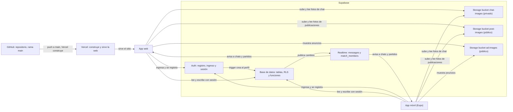

Archivos: `src/lib/supabase.ts`, `src/lib/images.ts`, `vercel.json`, `supabase/schema.sql`, `supabase/reservas.sql`

## 2. Modelo de datos

Son 17 tablas, así que el modelo se parte en dos. Se omite `auth.users`, que gestiona Supabase; `profiles.id` apunta a ella.

### 2a. Partidos y chats

Quién convoca, quién pide unirse, los chats del partido y los directos, y las tablas de comunidad y bloqueos.

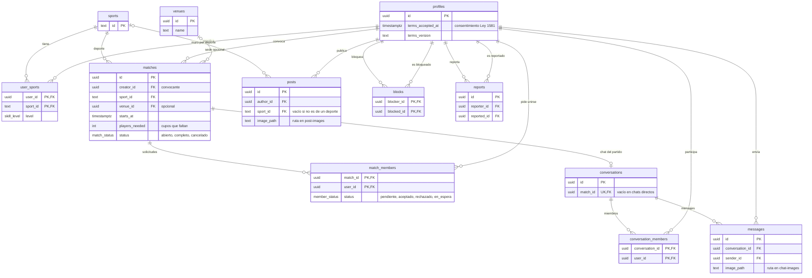

Archivos: `supabase/schema.sql`

### 2b. Reservas y publicidad

Sedes con aprobación del administrador, sus canchas y horarios, las reservas, los anuncios y quién es administrador. `ads` no tiene relaciones: se muestra por fechas.

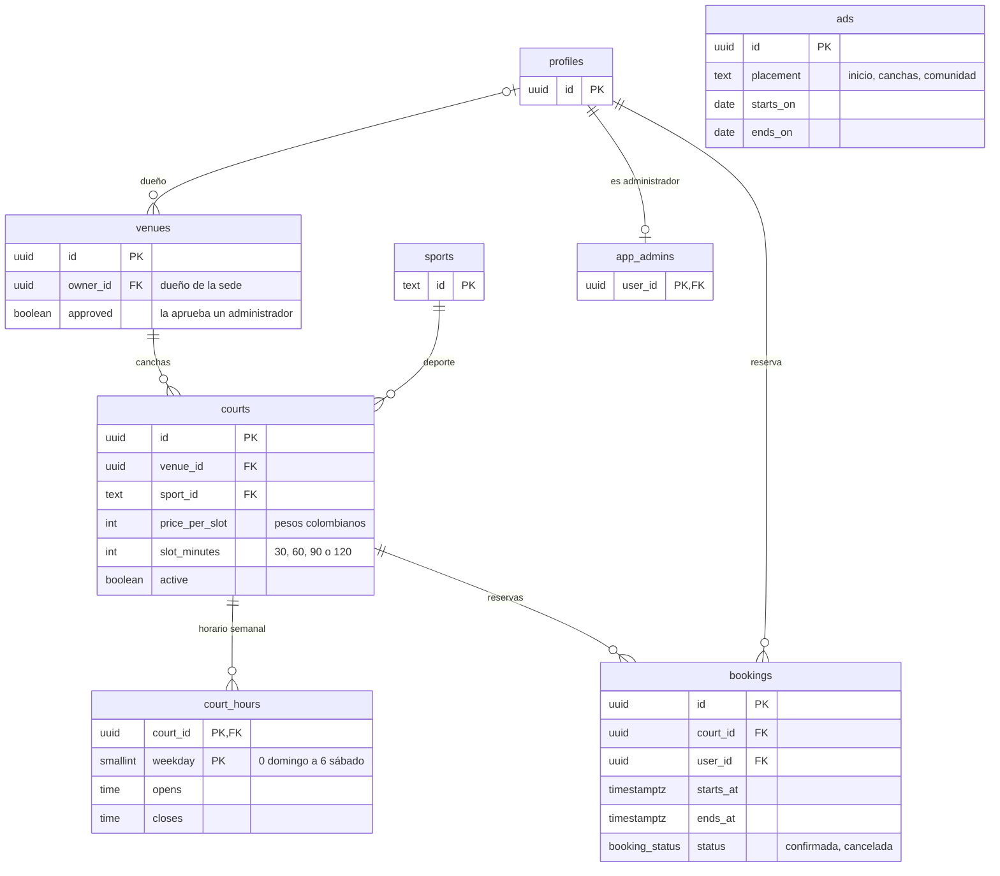

Archivos: `supabase/reservas.sql`, `supabase/schema.sql`

## 3. Pantallas y navegación

Todas las rutas de `src/app` pasan por el guardia de sesión de `_layout.tsx`, salvo `login` y `legal/[doc]`. Las pantallas de administración se comprueban dentro de la propia pantalla. Las de dueño de sede tienen la lista filtrada por `owner_id`, y la edición la limita la base de datos (RLS).

### 3a. Acceso y pestañas

Entrada sin sesión, pestañas principales y administración.

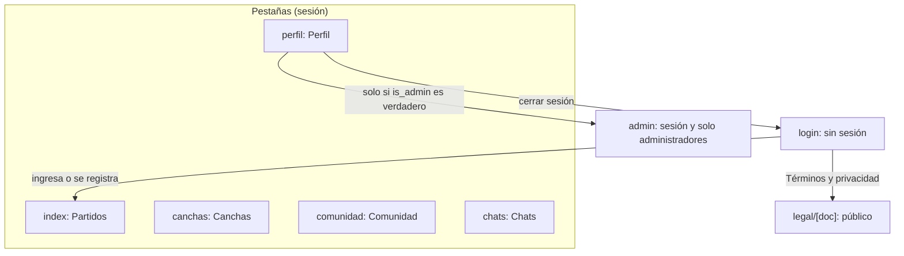

Archivos: `src/app/_layout.tsx`, `src/app/(tabs)/_layout.tsx`, `src/app/login.tsx`, `src/app/legal/[doc].tsx`, `src/app/(tabs)/perfil.tsx`, `src/app/admin.tsx`

### 3b. Pantallas de detalle

Lo que se abre desde las pestañas. Todas piden sesión.

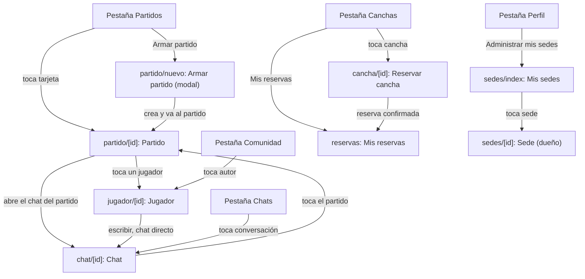

Archivos: `src/app/_layout.tsx`, `src/app/partido/nuevo.tsx`, `src/app/partido/[id].tsx`, `src/app/chat/[id].tsx`, `src/app/jugador/[id].tsx`, `src/app/cancha/[id].tsx`, `src/app/reservas.tsx`, `src/app/sedes/index.tsx`, `src/app/sedes/[id].tsx`

## 4. Flujos críticos

### 4a. Registro con consentimiento

La app valida nombre y casillas antes de enviar; el trigger de la base de datos vuelve a exigir el consentimiento y es quien crea el perfil.

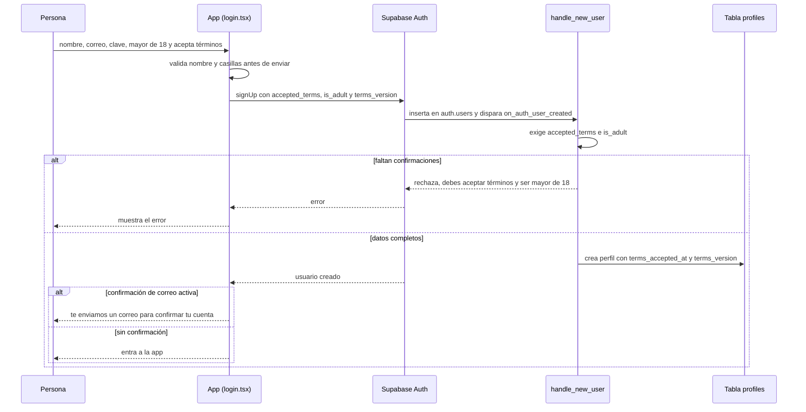

Archivos: `src/app/login.tsx`, `supabase/schema.sql` (funciones `handle_new_user` y trigger `on_auth_user_created`)

### 4b. Unirse a un partido y aceptar

Quien pide unirse entra como pendiente si hay cupo, o en espera si el partido está completo. El convocante acepta; la base de datos comprueba el cupo y, al aceptar, agrega a la persona al chat del partido.

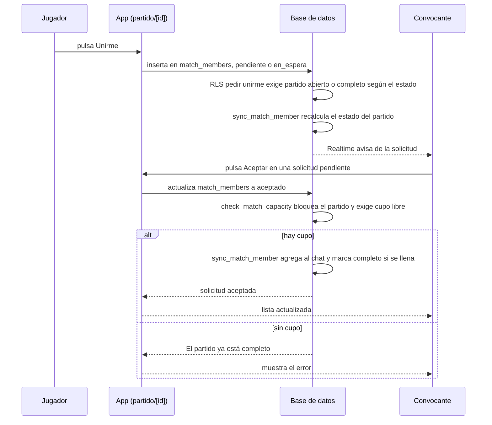

Si alguien sale del partido y libera un cupo, `sync_match_member` pasa al primero de la lista de espera a pendiente. Archivos: `src/app/partido/[id].tsx`, `supabase/schema.sql` (funciones `check_match_capacity` y `sync_match_member`, triggers `before_match_member_change` y `on_match_member_change`)

### 4c. Reservar una cancha

La app pide los turnos ocupados sin saber quién reservó; la base de datos valida todas las reglas dentro de `book_court`.

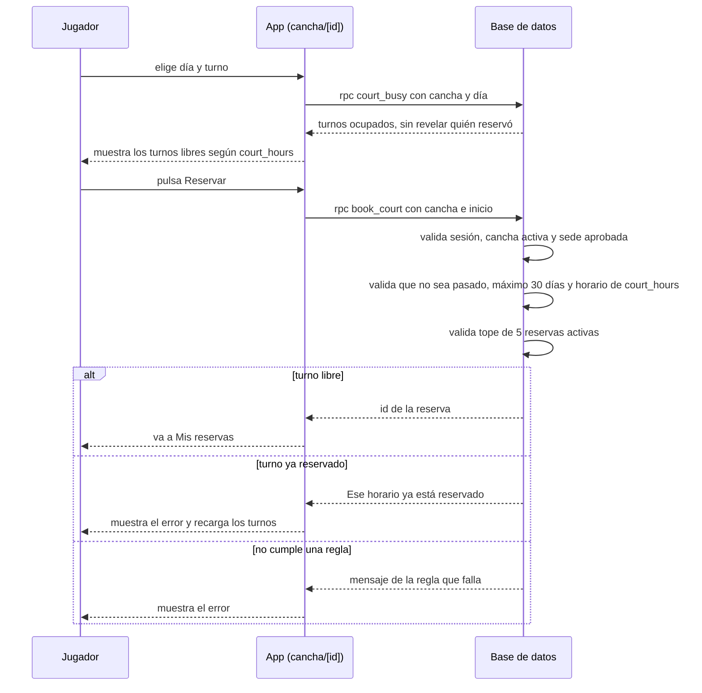

Archivos: `src/app/cancha/[id].tsx`, `supabase/reservas.sql` (funciones `court_busy` y `book_court`)

### 4d. Eliminar cuenta

La app borra primero las imágenes de la persona en Storage y luego llama a `delete_my_account`, que borra el usuario de Auth y, en cascada, sus datos.

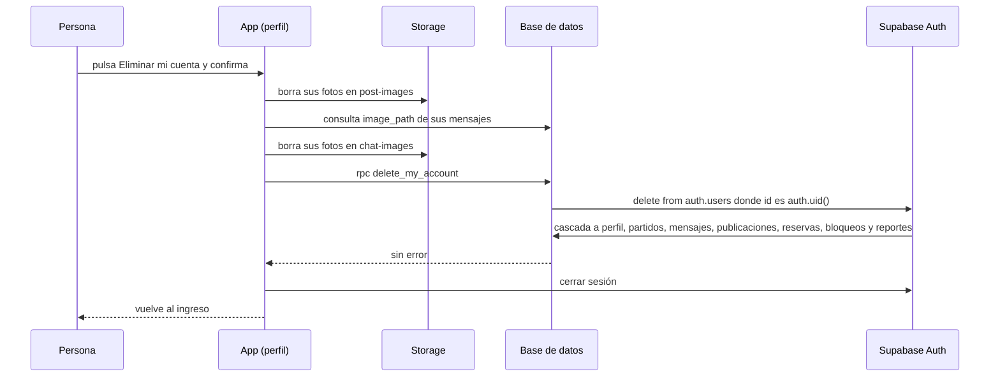

Archivos: `src/app/(tabs)/perfil.tsx`, `src/lib/images.ts` (funciones `removeMyPostImages` y `removeMyChatImages`), `supabase/schema.sql` (función `delete_my_account`)

## 5. Estados

Son columnas de tipo enum, salvo la sede, que solo tiene el booleano `approved`. Los nombres de la sede son etiquetas del diagrama.

### 5a. Partido (`match_status`)

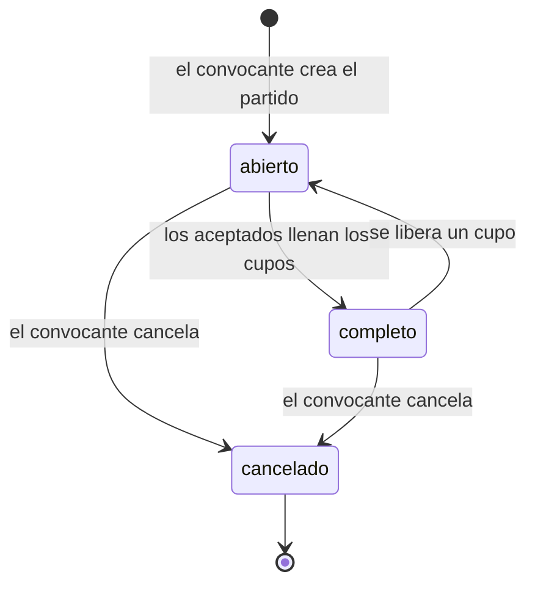

Archivos: `supabase/schema.sql` (tipo `match_status`, función `sync_match_member`)

### 5b. Solicitud de jugador (`member_status`)

La pantalla solo ofrece aceptar o rechazar las solicitudes pendientes. La política RLS del convocante permite cambiar cualquier estado, pero la app no lo usa.

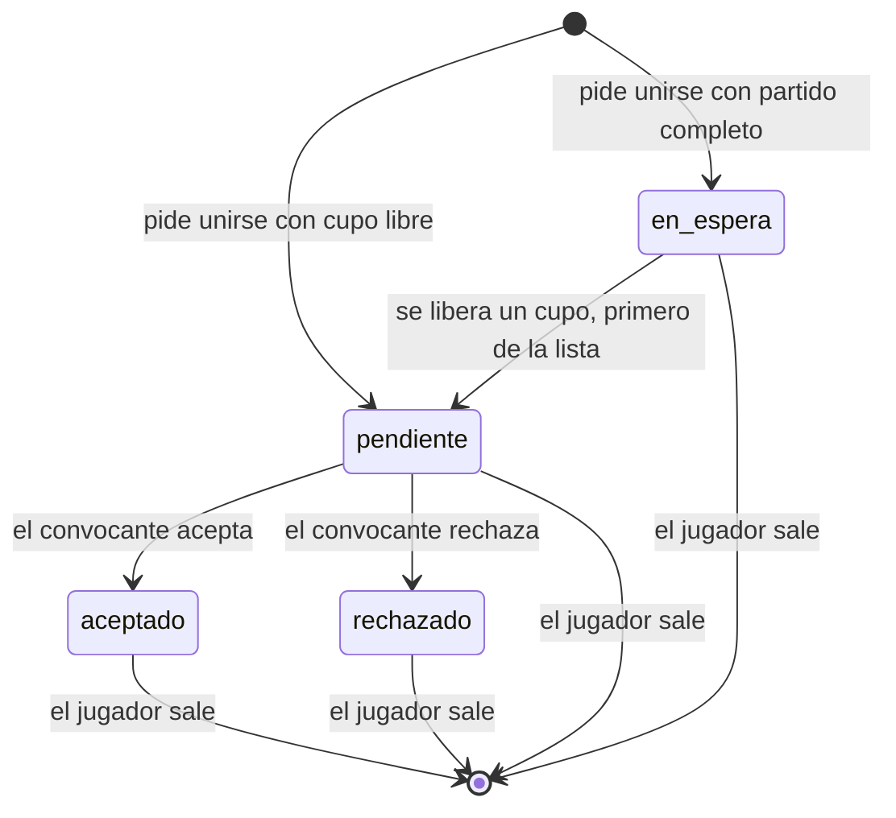

Archivos: `supabase/schema.sql` (tipo `member_status`, políticas de `match_members`, función `sync_match_member`)

### 5c. Reserva (`booking_status`)

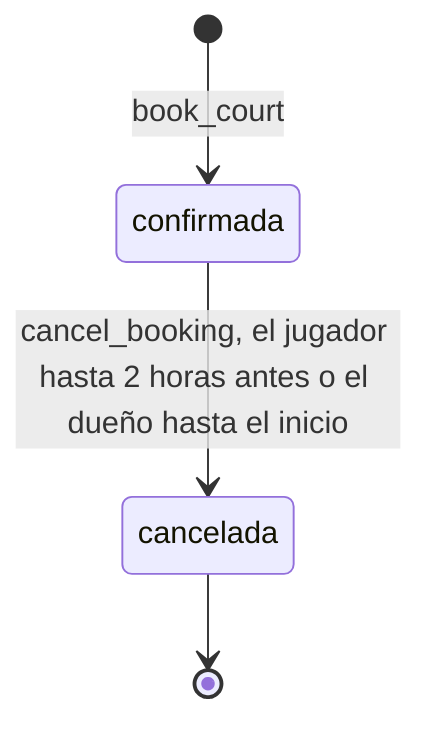

Archivos: `supabase/reservas.sql` (tipo `booking_status`, funciones `book_court` y `cancel_booking`)

### 5d. Sede (`approved`)

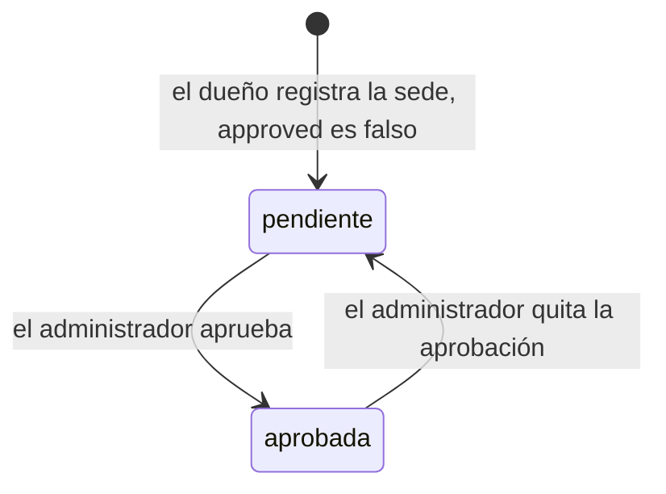

Archivos: `supabase/reservas.sql` (columna `approved` en `venues`, función `approve_venue`)

## 6. Despliegue

De la rama `main` al sitio publicado, y lo que se aplica a mano en Supabase. El orden importa: `reservas.sql` quita una política creada en `schema.sql`, así que va después. La app móvil no tiene configuración de build en el repo (no hay `eas.json`).

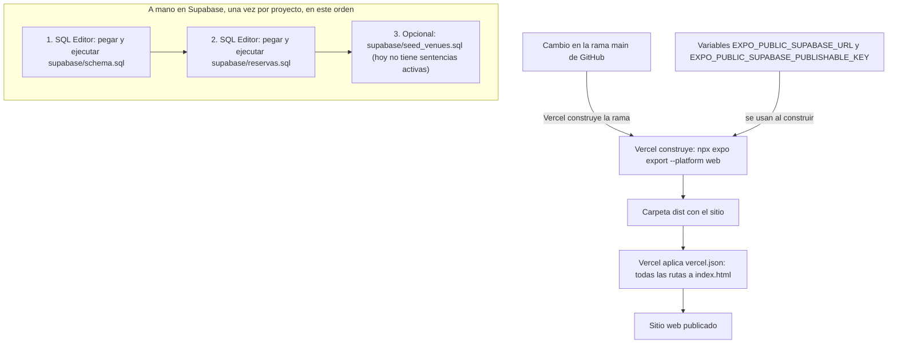

Archivos: `vercel.json`, `package.json`, `supabase/NUEVO_PROYECTO.md`, `supabase/schema.sql`, `supabase/reservas.sql`, `supabase/seed_venues.sql`
